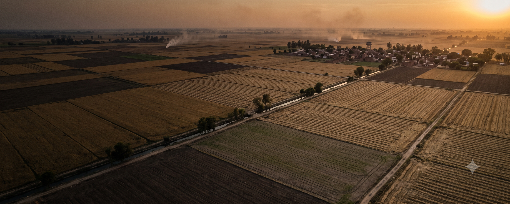
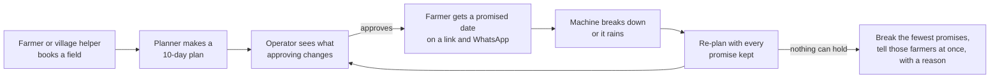
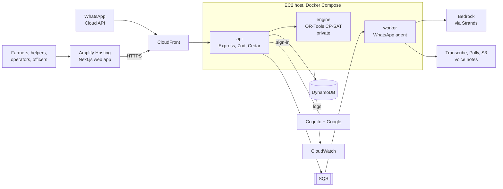

<p align="center">
  
</p>

<h1 align="center">Vaari ਵਾਰੀ</h1>

<p align="center"><b>Your turn, guaranteed. No fire needed.</b></p>

<p align="center">
  Every farmer gets a <b>promised date</b> for the machine that sows wheat into paddy stubble,<br>
  so nobody burns their field while waiting for a Super Seeder.
</p>

<p align="center">
  <a href="https://main.d2n4tg60h10ven.amplifyapp.com/"><b>Live app</b></a> ·
  <a href="https://youtu.be/LLdcgSdiGdA"><b>Demo video (3 min)</b></a> ·
  <a href="https://main.d2n4tg60h10ven.amplifyapp.com/proof"><b>The evidence</b></a> ·
  <a href="#run-it-yourself">Run it yourself</a>
</p>

<p align="center">
  
  
  
  
  
</p>

Built in four days for the **WeMakeDevs x AWS Environmental Hacks**, Air track, 8-11 October 2026.

> **Honesty first.** Every farmer, field, machine and breakdown in the demo is **simulated**, and the names are invented. Village names and positions are real (OpenStreetMap), and harvest timing is calibrated from real NASA FIRMS fire detections. Every number below comes from a cited source or a real, reproducible simulator run.

---

## Watch it

<p align="center">
  <a href="https://youtu.be/LLdcgSdiGdA">
    
  </a>
</p>

Or try it in one click, no sign-up: open the [live app](https://main.d2n4tg60h10ven.amplifyapp.com/) and press **Try as farmer** or **Try as operator**. Facilitator and officer demo accounts are on [`/signin`](https://main.d2n4tg60h10ven.amplifyapp.com/signin).

## The problem

After the paddy harvest a Punjab farmer has a short window to sow wheat. Machines that sow straight into the stubble exist, but there are not enough of them, and nobody can tell a farmer **when** one will come. [CEEW](https://www.ceew.in/blogs/why-punjab-farmers-burn-paddy-stubble-and-steps-to-curb-crop-burning) found that this uncertainty over machine arrival is a main reason farmers burn. Waiting has a price too: each week of sowing delay past the optimum costs about **150 kg of wheat per acre** ([PAU Package of Practices, Rabi](https://pau.edu/content/ccil/pf/pp_rabi.pdf)).

Booking apps let a farmer *ask* for a machine. Nothing plans the machine centre's days, **promises** a date, or re-plans honestly when a machine breaks down. That is the gap Vaari fills.

## What Vaari does

The person who decides is the **Custom Hiring Centre (CHC) operator**, running 3-5 machines across a cluster of villages. Each evening Vaari gives them one answer:

> *Tomorrow: Machine 1 does Balian then Ubhawal. Machine 2 is in the workshop; its 4 fields move to Machine 3 and Thursday. 41 promises open, all on track. 3 fields at burn risk: offer them Wednesday morning.*

The operator checks what approving changes, then approves. Only then does each farmer get a **numbered token**, like a bank queue token, with a firm date (next 2 days) or a window that narrows to a firm date. If the date ever moves, the farmer is told why in one sentence. They get it on a signed link and on WhatsApp, in Punjabi, Hindi or English.



| Who | What they do in Vaari |
|---|---|
| **Farmer** (no account: their phone number is who they are) | Opens their field's slot link, or all their fields after a one-time WhatsApp login link or code; books their own field; says "I cannot wait longer"; asks "why this date?" on WhatsApp, typed or as a **voice note** |
| **Village helper** | Books fields for 10-30 farmers with each farmer's phone and consent; resends a lost link (the old one stops working) |
| **CHC operator** | Plans 10 days; moves a field and sees what that changes ("this moves 2 promises, 0 break") before confirming; approves; marks a machine down and watches the re-plan; logs work so each machine's real speed is learned |
| **District agriculture officer** | Sees every centre in their district and the fields at risk (totals only, never farmers' contact details), and where a machine could be lent |

## Results (simulated)

Fifty simulated seasons of the **whole of Sangrur district**: its real outline, 409 villages, 25 machine centres, 100 Super Seeders and about 2,400 fields a season. Three ways of working, on identical seeded seasons. Median, with the 10th-90th percentile spread.

| Per season | Phone queue (first come, first served) | Nearest village next | **Vaari** |
|---|---|---|---|
| Farmers not reached by their last waiting day | 332 (295-396) | 331 (291-406) | **68 (49-114)** |
| Acres burned | 1,697 (1,487-2,030) | 1,602 (1,409-1,947) | **573 (401-879)** |
| PM2.5 from that straw | 46.2 t (40.5-55.3) | 43.7 t (38.4-53.0) | **15.6 t (10.9-23.9)** |
| Days a farmer waits without a date (average) | 1.6 | 1.46 | **0.26** |
| Promises kept | no promises | no promises | **92% (86-96%)** |
| Acres sown per machine | 124 | 125 | **135** |
| Income per machine (at about Rs 2,000 an acre, CEEW) | Rs 2.48 lakh | Rs 2.50 lakh | **Rs 2.70 lakh** |

- Vaari reached more farmers in time than the phone queue in **50 of 50** paired seasons (a median of 260 more a season).
- **Fewer fields burn, and machines earn more.** Machines drive less between farmers (33,300 km a season against the phone queue's 37,750), and each sows about 11 more acres a season.
- **What it does not fix, said plainly.** Wheat lost to late sowing is about the same under all three ways of working (about 78,000 kg a season); too few machines is still too few machines. To save fields from burning, Vaari sometimes moves a farmer who can wait later than the phone queue would have: for the one farmer worst off in a season, a median of 8 days later (6-10). That trade is penalised in the planner and reported, never hidden.
- **The headline's one unmeasured assumption:** a farmer with no promised date gives up 2 days sooner than one with a date. No study measures this, so `/proof` sweeps it from 0 to 3 days. At the sweep centre, even at **0 days** Vaari has 4 late fields against the phone queue's 8.

Every input is in [`data/sim/assumptions.json`](data/sim/assumptions.json), each labelled "assumed" or "real range"; the full output is [`data/sim/results.json`](data/sim/results.json). Same seed, same file, byte for byte. Burned acres become tonnes of straw and kg of PM2.5 with sourced conversions (Punjab's report to the NGT, IPCC, Gadde et al.).

## How it decides: code decides, the model only explains

- **Two-stage planner.** Google OR-Tools **CP-SAT** assigns each field to a machine and a day over a 10-day horizon. Then each machine-day's stops are put in the exact best order (rarely more than 10 stops).
- **Promises are hard constraints.** Pass 1 minimises fields served after the farmer's last waiting day. Pass 2, with that fixed, minimises wheat lost (acres x 150/7 kg per day past the optimum), travel, fairness slack and unserved fields.
- **Cautious promises, busy machines.** Promises use a slow day for each machine (20th percentile of its learned speed), so they hold. Tomorrow's route uses the median, so machines are not idle. Speed starts from a prior spanning the sources (CEEW: about 5.3 acres in 8 hours; an agriculture department camp: 10-12 a day) and learns from the operator's work logs.
- **Re-planning never breaks a promise silently.** After a breakdown or rain, every promise stays hard. Only if that is impossible does minimal-break mode run: it breaks the fewest promises, starting with farmers who can wait longest, and tells them at once.
- **"Why Thursday?" comes from the solver.** Vaari re-solves with the field forced a day earlier, using CP-SAT assumptions. The constraints that block it ("Tuesday and Wednesday are full", "Machine 2 is down Tuesday") become the reasons.
- **A fast second planner.** For the simulator (thousands of plans), and as a fallback when CP-SAT runs out of time, an earliest-deadline plan is improved by seeded local search. On 200 small random instances it matches the brute-force optimum on 198, and it is never worse on promises, deadlines or unserved fields.
- **The language model only phrases.** On WhatsApp, a Strands agent on Amazon Bedrock may only word what the planner decided. Before a reply is sent, code checks that every number, date, weekday and month in it appears in that turn's tool results, in all three scripts. If the check fails, or Bedrock is off, the farmer gets a template message instead. The product works with the model switched off.

## Built on AWS



| Service | Its job in Vaari |
|---|---|
| **Amplify Hosting** | Serves the Next.js web app, rendered on the server |
| **CloudFront** | HTTPS in front of the API on EC2, with caching off for API routes |
| **EC2 + Docker Compose** | Runs the `api`, `engine` and `worker` containers ([`backend/docker-compose.yml`](backend/docker-compose.yml)) |
| **ECR, IAM (GitHub OIDC), SSM Run Command** | On every push to `main`, [CI](.github/workflows/backend.yml) tests, builds images to ECR and deploys on EC2, with no keys stored and no SSH; a failed health check rolls back |
| **Cognito** | Staff sign-in (helper, operator and officer groups), with Google federation and PKCE |
| **DynamoDB** | Fields, promises, plans and work logs, one table per entity; approving a plan is a conditional write, so it can't be approved twice |
| **SQS** | Decouples the WhatsApp webhook from the worker |
| **Bedrock** (through Strands Agents) | Words WhatsApp replies, checked by code before sending |
| **Transcribe, Polly, S3** | Voice notes in and out. Polly has no Punjabi voice, so Punjabi replies are read by the Hindi voice from Devanagari. Each note sits in S3 only while it is transcribed |
| **CloudWatch** | Container logs |

**AWS open source in the product:** [Cedar](https://www.cedarpolicy.com/) (`@cedar-policy/cedar-wasm`, in-process authorisation, deny by default) and [Strands Agents](https://strandsagents.com/) (the WhatsApp agent).

## Trust, privacy and safety

- **Farmers need no account and no password.** A slot link is a signed token for one field. A one-time login link expires in 15 minutes, can be used once, and only its hash is stored. Sign-in codes allow 5 tries and are stored as HMACs. Resending a link makes every older one stop working.
- **The browser never holds a token.** Next.js route handlers keep sessions in httpOnly, SameSite cookies and call the API on the user's behalf.
- **Cedar decides who sees what.** A phone sees only its own fields. A helper sees only the fields they booked. An operator sees only their own centre. An officer sees totals for their own district only. Officer and public responses never include a farmer's phone number (tested).
- **No accusations.** Satellites show heat, not intent; Vaari never says a farmer burned. Each satellite passes about twice a day and misses short, small or cloud-covered fires, so every fire count here is a **lower bound**.

## Run it yourself

Needs Node 22+ and [uv](https://docs.astral.sh/uv/) (uv installs Python 3.12 and OR-Tools for the engine). **No AWS account needed.**

```bash
make setup            # backend (npm + Python engine) and frontend
make dev              # API on :4000, web on :3000 (or `npm run dev` in backend/ and frontend/)
```

Open http://localhost:3000 and press **Try as farmer** or **Try as operator**.

**The whole loop in two minutes:**
1. Sign in as the helper, book a field on `/dashboard/book` (farmer's name, phone and consent), and copy the farmer's link.
2. Open the link in a private window. It says *Requested*.
3. Sign in as the operator. On `/dashboard/plan`, press **Make a fresh plan**, read *What approving does*, optionally move a field, then **Approve and publish**.
4. Reload the farmer's link: a firm date, the machine and its stop, and the reason in one sentence.

**Watch the planner in a terminal, no server:**

```bash
cd backend
npm run plan -- --seed 1                                         # a simulated 34-field cluster, planned in about 0.2 s
npm run plan -- --seed 1 --down m2:2026-11-02 --rain 2026-11-03  # a breakdown and rain: promises kept, or which broke and why
npm run plan -- --seed 1 --compare                               # CP-SAT against the search planner, on one objective
```

**Prove it:**

```bash
make test             # engine invariants + brute-force comparison, then the API (Cedar allow/deny, core loop, contract, WhatsApp)
cd frontend && npm test               # web components and route handlers
cd frontend && npm run test:e2e       # Playwright flows (own servers on :3100/:4100, installed Chrome)
make simulate-check   # reproducibility: plays 5 seasons twice, files must match byte for byte
make simulate         # the full 50-season district run behind /proof (about 35 minutes on 4 cores)
```

At submission: **62 engine tests, 344 API tests and 199 web tests, all passing.** The engine always checks that:
- every promise is kept in every feasible plan;
- no field is sown before it is ready;
- no machine works beyond its hours;
- minimal-break mode breaks nothing when a plan without breaks exists.

**With AWS:** set `REPO=dynamo`, `TABLE_PREFIX` and `AWS_REGION` in `backend/.env`, then run `npm run db:create`. Production runs on EC2 with `./deploy/deploy.sh`; setup is in [`backend/deploy/README.md`](backend/deploy/README.md).

## Inside the repo

```
backend/            Express + TypeScript API
  src/              auth, Cedar authorisation, planner client, routes, DynamoDB / in-memory store
  src/shared/       Zod contract between web, API and engine (the source of truth)
  src/whatsapp/     webhook, SQS worker, Strands agent, number check, voice notes
  policies/         Cedar policies (vaari.cedar)
  engine/           Python 3.12: CP-SAT model, routing, explanations, learned rates, simulator (no AWS imports)
  scripts/data/     builds data/ from OpenStreetMap and NASA FIRMS
  deploy/           EC2 deploy script and IAM policies
frontend/           Next.js 15 (App Router), Tailwind 4, Motion, TanStack Query, next-intl (en, hi, pa)
data/               villages, harvest curves, district outlines, simulator inputs and results (see data/README.md)
```

## Assumptions and limits

- **Simulated:** farmers, fields, machines, breakdowns and rain. **Real:** village positions and district outlines (OpenStreetMap), harvest timing (NASA FIRMS, 2024 and 2025 seasons, S-NPP and NOAA-20, shifted 3 days earlier because fire follows harvest; see [`data/README.md`](data/README.md)).
- **Assumed, and labelled in the UI:**
  - road distance is straight-line x 1.3 at 20 km/h (the engine accepts a real route matrix when there is one);
  - 15 minutes of setup per field;
  - 8-hour machine days;
  - field sizes 1.5-6 acres;
  - farmers wait 3-10 days.
- The committed results were written before the half-the-machines scenario was added. `/proof` shows the base scenario and the sweeps; a fresh `make simulate` adds "where Vaari cannot save everyone".
- The WhatsApp bot runs on Meta's test number, so it is shown in the video. Punjabi and Hindi text has not yet been checked by a native speaker.

## Sources

| Fact | Source |
|---|---|
| Each week of sowing delay past the optimum costs about 150 kg wheat per acre | [PAU Package of Practices, Rabi](https://pau.edu/content/ccil/pf/pp_rabi.pdf) |
| Uncertainty over machine arrival pushes farmers to burn | [CEEW](https://www.ceew.in/blogs/why-punjab-farmers-burn-paddy-stubble-and-steps-to-curb-crop-burning) |
| Super Seeder about 5.3 acres in 8 h (CEEW) vs 10-12 a day (agriculture department camp, Jalandhar, 2019) | CEEW annexure; [The Tribune, Jalandhar](https://www.tribuneindia.com/news/archive/jalandhar/news-detail-863925) |
| Full Super Seeder package rents for about Rs 2,000 per acre; CHC break-even near 105 acres a season | CEEW CHC publication and annexure |
| 663 hotspot villages in eight districts had nearly two-thirds of Punjab's 10,909 farm fires in 2024 | [The Tribune, 2 Oct 2025](https://www.tribuneindia.com/news/punjab/team-of-22-scientists-to-check-farm-fires) |

We acknowledge the use of data from NASA's Fire Information for Resource Management System (FIRMS), part of NASA's Earth Science Data and Information System (ESDIS). Villages and outlines © OpenStreetMap contributors, [ODbL 1.0](https://www.openstreetmap.org/copyright).

<p align="center"><i>ਵਾਰੀ (vaari) is Punjabi for "turn". Everyone gets theirs.</i></p>
